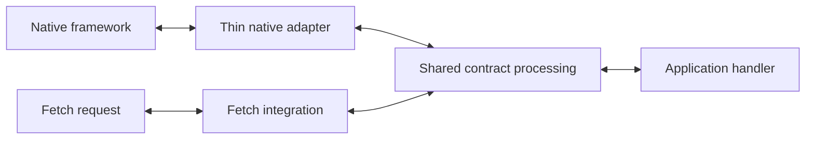

# Adapter maintenance reduction epic

**Recorded:** 2026-11-04. **Source baseline:** `534d761bf0629ac196ce9941ff95cf75abdb4719`.

**Status:** Incremental implementation. The user approved A01/A02 on 2026-11-04 and adopted the support-policy baseline. A01 documentation and A02 conformance coverage are delivered. A04 core response evaluation and Express adoption merged in PR #13 with passing compatibility CI. A05 response adoption in Fastify merged in PR #14 with passing CI; request adoption remains outstanding. A06 response adoption in Next is implemented with source/packed verification; its CI remains required. A03 and A07–A19 remain unstarted. These approvals do not authorize dependency support removals, API removals or publication.

**Goal:** Reduce the work needed to maintain contract behavior and keep integrations compatible as native frameworks and query libraries change.

**Design basis:** The adapter architecture discussion in this chat on 2026-11-03, captured below so future work does not depend on chat history.

**Technology baseline:** TypeScript, Standard Schema, Fetch, pnpm 12.14.0, Node 26.12.0, Vite+, Vitest and Changesets. Recheck the checkout's pinned versions when a slice starts.

> **For future implementers:** Select one slice, verify its prerequisites against the current checkout, and obtain approval of its scoped design. Then use `writing-plans` to produce that slice's executable implementation plan and `executing-plans` to deliver it. This epic is a deliverable backlog, not an instruction to execute all slices. Use unchecked criteria below to track work; record commits, verification evidence and any intentional compatibility changes when completing a slice.

## Problem and current evidence

Server adapters share low-level validation utilities but repeat request-validation orchestration and response handling. Framework-specific routing, lifecycle integration and public native types create additional compatibility obligations. Consolidating validation alone will not address client hook wrappers, broad support windows or coordinated releases.

| Concern                                         | Current evidence                                                                                                                                                                                                                                    |
| ----------------------------------------------- | --------------------------------------------------------------------------------------------------------------------------------------------------------------------------------------------------------------------------------------------------- |
| Repeated parsed-request validation              | `libs/ts-rest/express/src/lib/ts-rest-express.ts`, `libs/ts-rest/fastify/src/lib/ts-rest-fastify.ts`, `libs/ts-rest/next/src/lib/ts-rest-next.ts`, `libs/ts-rest/nest/src/lib/ts-rest-nest-handler.ts`, `libs/ts-rest/serverless/src/lib/router.ts` |
| Native lifecycle and declaration coupling       | Express optional-path translation; Fastify request/reply/hook generics; Nest decorators, RxJS and Express/Fastify response integration                                                                                                              |
| Fetch still exposes a router dependency         | `libs/ts-rest/serverless/src/lib/request.ts` implements `itty-router`'s `IRequest`; `types.ts` imports its middleware and CORS types                                                                                                                |
| Query adapters reproduce native APIs            | `libs/ts-rest/react-query-v5/src/v5/internal/create-hooks.ts` and `types/hooks-options.ts`; Vue and Solid query adapters                                                                                                                            |
| Compatibility evidence covers selected versions | `.github/workflows/build-test.yml`, `test-projects/`, `tests/packaging/`                                                                                                                                                                            |
| Release versions are coordinated                | `.changeset/config.json` uses a fixed group of ten public `@ts-restless` libraries; `tests/releases/versioning.test.mjs` encodes coordinated version expectations                                                                                   |

These are checkout-specific observations. No arbitrary newer dependency versions were tested for this epic, and package peer ranges are not proof of every version's compatibility.

## Target architecture



- **Shared contract processing:** Parsed request validation, Standard Schema transforms, structured location failures, contract response validation and response metadata. Extend existing core utilities; keep framework and router types outside their dependency graph.
- **Native bridges:** Routing, parsing, middleware/hooks, DI, lifecycle placement, native context, response writing, streaming and native error mapping. Call shared operations at the correct lifecycle point rather than impose a universal dispatcher.
- **Portable Fetch integration:** A standard `Request`/`Response` entry point with ts-rest-owned public context and middleware types. Routing remains an implementation detail; replacing the existing router is not a prerequisite.
- **Client integrations:** Reuse the core HTTP client and common success/error/cancellation policy. Prefer small typed functions and option helpers that compose with native hooks and cache APIs. Keep native reactivity and library-owned types in their own integration.
- **Compatibility and delivery:** Explicit support windows, reusable conformance scenarios, strict packed consumers, bounded rolling checks and independent adapter releases where dependency relationships permit them.

## Constraints and decisions

### Constraints for every slice

- Preserve the validator-independent default entry graph and explicit `/zod3` compatibility boundary. Do not add validator-specific branches or require a validator to use default APIs.
- Preserve synchronous schema validation; asynchronous schema support is outside this epic.
- Preserve current public APIs and observable adapter behavior during internal extraction. Separately approved breaking changes require migration documentation and appropriate Changesets.
- Preserve native context typing, parsing ownership and lifecycle behavior. Do not solve declaration incompatibility with `any`, pervasive casts or `skipLibCheck`.
- Do not consume a body twice, force native streams through JSON serialization, or move hooks/DI into core. Preserve multi-value headers, cookies and query values at their existing boundaries.
- Preserve each adapter's current error classes, serialized failure locations, options and response behavior until a deliberate change is approved. Shared results must support policy differences without a framework-name switch in core.
- Preserve current stable/prerelease workflow publication controls. Do not version, publish or rename packages as part of internal refactors.
- Reuse existing tooling, package tests and native release packing. Add abstractions only where two real consumers establish a shared need; keep new helpers cohesive with existing core request/response code.
- Each slice must leave the checkout usable and independently reviewable. Include its tests and docs in the same delivery; avoid unused scaffolding commits.

### Decisions that require approval before their dependent changes

| Decision                          | Recommended direction                                                                                  | Decision gate                                                                                     |
| --------------------------------- | ------------------------------------------------------------------------------------------------------ | ------------------------------------------------------------------------------------------------- |
| Supported native dependency lines | Current major plus a previous-major migration window, with exact floors and a dated retirement policy  | A01 records an approved policy before peer narrowing or fixture retirement                        |
| Portable Fetch public API         | Reuse existing entry points where possible; own public middleware/context types                        | A09 approves precise signatures and compatibility treatment                                       |
| Smaller client API                | Typed functions/helpers composed with native hooks; retain existing wrappers during migration          | A12 approves the React API and its inferred results/errors; A14/A15 approve native reactive forms |
| Independent package versions      | Remove blanket fixed-group coupling; retain genuine bundled/private relationships                      | A17 approves package groups and core peer semantics after real versioning probes                  |
| Compatibility retirement          | Retire one selected surface in an appropriate major after its replacement and migration evidence exist | A19 approves the specific surface, date and release impact                                        |

The [compatibility support and retirement policy](../../support-policy.md) is adopted: one active verified dependency major plus a previous-major migration window, at least six calendar months' notice and removal in a major release. The [A01 inventory](../../support-inventory.md) retains existing broader ranges as explicit exceptions and records their coverage gaps. No new version floor, retirement notice or removal date is approved. The [release-focused backlog](../../release-readiness-backlog.md) records the adoption fixes that can ship alongside this epic.

## Slice register

Scope sizes are relative: **S** is a focused documentation/test/API change; **M** is one integration or bounded cross-package extraction. They are not delivery estimates. If a slice grows beyond that boundary, split it before implementation.

| ID  | Independently deliverable outcome                                      | Prerequisites    | Size | Status                                                         |
| --- | ---------------------------------------------------------------------- | ---------------- | ---- | -------------------------------------------------------------- |
| A01 | Support inventory and approved maintenance policy                      | None             | S    | Complete (docs)                                                |
| A02 | Shared HTTP conformance scenarios running on Express and Fastify       | None             | M    | Complete (tests)                                               |
| A03 | Shared parsed-request evaluation used by Express                       | A02              | M    | Unstarted                                                      |
| A04 | Shared response preparation used by Express                            | A02              | M    | Complete; merged in PR #13                                     |
| A05 | Fastify uses both shared operations                                    | A03, A04         | M    | Partial: response merged in PR #14; request outstanding        |
| A06 | Next uses shared contract operations                                   | A03, A04         | M    | Partial: response verified locally; CI and request outstanding |
| A07 | Nest uses shared contract operations inside its lifecycle              | A03, A04         | M    | Unstarted                                                      |
| A08 | Serverless uses shared contract operations                             | A03, A04         | M    | Unstarted                                                      |
| A09 | Fetch public declarations no longer expose itty-router types           | A08              | M    | Unstarted                                                      |
| A10 | A documented portable Fetch journey proven in a host                   | A09              | S    | Unstarted                                                      |
| A11 | Common query execution policy used by existing React Query v5 wrappers | None             | M    | Unstarted                                                      |
| A12 | Additive React native query and mutation composition                   | A11              | M    | Unstarted                                                      |
| A13 | React native infinite-query composition                                | A12              | S    | Unstarted                                                      |
| A14 | Vue adopts common execution and native composition                     | A11, A12         | M    | Unstarted                                                      |
| A15 | Solid adopts common execution and native composition                   | A11, A12         | M    | Unstarted                                                      |
| A16 | Policy-driven packed compatibility and rolling dependency checks       | A01, A02         | M    | Unstarted                                                      |
| A17 | Independent adapter versioning proven in disposable release probes     | A01              | M    | Unstarted                                                      |
| A18 | Native upgrade rehearsal and migration guide                           | A05–A10, A12–A17 | S    | Unstarted                                                      |
| A19 | First approved legacy-surface retirement                               | A01, A18         | S    | Unstarted                                                      |

Server migrations A06–A08 can proceed independently after the shared boundaries stabilize. Client work and release work need not wait for every server migration. A16 extends its scenario runner as each integration lands.

## Deliverable slices

### A01 — Support inventory and maintenance policy

**Outcome:** Maintainers can tell which dependency lines are supported, why, and what evidence is required before changing that promise.

**Scope:** Complete and adopt the [support policy](../../support-policy.md); reconcile library manifests, workspace catalogs, `CONTRIBUTING.md`, CI fixtures and native declarations. Include framework majors, query-library lines, TypeScript resolution modes and runtime requirements. Distinguish workspace baselines from packed consumer evidence.

- [x] Record current peer ranges and existing coverage without narrowing either.
- [x] Record exact existing floors, working lines, retained exceptions and the approved process for adding a line. No new floor or retirement date is approved; no retirement clock has started. Vue/Solid v4 remain active until verified replacements exist.
- [x] Record which matrix fixtures prove each promised line and which gaps require new coverage.
- [x] Document how a compatibility bug is triaged and which package owns the fix.

**Verification:** Review every row against package manifests and `.github/workflows/build-test.yml`; document gaps honestly. This slice changes documentation only.

### A02 — Reusable HTTP conformance scenarios

**Outcome:** One behavior change can be assessed against two real adapters with the same scenarios.

**Scope:** Add test-only scenario definitions under `tests/conformance/`; wire them into the existing Express and Fastify spec files using their native HTTP test facilities. Reuse existing contract fixtures and assertion patterns.

- [x] Exercise parsed params/query/body, header casing, optional/defaulted/transformed values, passthrough keys, declared error responses, invalid requests, response-validation failure and no-body/non-JSON responses.
- [x] Separate common contract assertions from adapter-specific failure formatting and lifecycle expectations. Capture actual differences rather than changing behavior to make tests agree.
- [x] Prove native handlers receive validated values and native context; retain middleware/hook-order and stream tests in adapter suites.
- [x] Keep fixtures reusable without creating a production test dependency or a second test runner.

**Verification:** Express and Fastify source suites pass; intentionally changing a shared expected value makes both hosts' corresponding assertions fail. Existing native-specific regressions remain covered.

### A03 — Shared parsed-request evaluation, with Express adoption

**Outcome:** Express obtains contract-validated inputs from a framework-independent core operation.

**Scope:** Core request-validation utilities and exports; Express `ts-rest-express.ts`; core/Express tests and declarations. Define the exact result interface in this slice's plan before implementation.

- [ ] Accept already-parsed params, headers, query and body plus explicit validation policy. Return validated values and location-specific failures without native exceptions.
- [ ] Reuse `validateIfSchema`, `validateMultiSchemaObject` and JSON-query parsing; preserve missing/defaulted/false/zero values and path-param passthrough behavior.
- [ ] Replace Express's repeated validation orchestration; Express retains parsing, native error construction and error-handler dispatch.
- [ ] Verify exported declarations/runtime modules contain no framework or router imports.

**Verification:** Core/Express source, inference and packed-consumer checks pass. A valid transformed request and an invalid request keep their observable Express behavior.

### A04 — Shared response preparation, with Express adoption

**Outcome:** Express reuses framework-independent contract response validation and metadata preparation.

**Scope:** `core/src/lib/server.ts` and adjacent tests/exports; Express response handling and regressions. Extend existing response validation rather than replace it with another engine.

- [x] Define a neutral response result containing status, validated body and relevant contract metadata for body presence/content type. Keep serialization and native writes adapter-owned.
- [x] Preserve response-validation enablement, schema transforms, declared response errors and current status handling. Characterize missing-schema behavior rather than standardize it silently.
- [x] Preserve Express's stream bypass and native handling; no forced buffering or JSON conversion.
- [x] Reuse the operation in Express's ordinary/no-body/non-JSON response paths.

**Verification:** Core/Express conformance and native stream tests pass; invalid response bodies fail as before and native error middleware still receives errors.

### A05 — Fastify adoption of shared operations

**Outcome:** The same core boundaries work in a second native lifecycle without duplicating contract policy.

**Scope:** Fastify implementation, hook/context declarations and native tests; extend core policy only for a demonstrated contract-level requirement.

- [x] Replace response orchestration with A04 evaluation; see [Fastify response plan](../../../plans/003-fastify-response-evaluation.md).
- [ ] Replace request orchestration with A03 evaluation after that capability is implemented.
- [x] Preserve hooks, route config, error-handler behavior, native request/reply types and serialization ownership during response adoption.
- [x] Preserve conformance outcomes for valid, invalid, transformed and non-JSON requests/responses during response adoption.
- [x] Verify the supported Fastify 4 line from A01; adding another major is a separately scoped compatibility change, not an assumed benefit of extraction.

**Verification:** Fastify source and inference suites pass; packed consumers compile strictly; hooks run in their original order. Review the bridge for remaining duplicated contract logic.

### A06 — Next adoption of shared operations

**Outcome:** The native Next adapter retains its routing/error callbacks while reusing contract processing.

**Scope:** `next/src/lib/ts-rest-next.ts`, path utilities and tests; Next docs where internal assumptions affect users. Serverless Next wrappers remain in A08.

- [x] Adopt A04 response handling; see [Next response plan](../../../plans/005-next-response-evaluation.md).
- Response packed evidence: strict ESM/CommonJS declarations against Next 12.3.7 and native HTTP execution against Next 16.4.2, verified on Node 26.12.0. Next 12's eager bundled JWT import uses the removed `SlowBuffer` API on Node 26; the disposable consumer switches Next versions after declaration compilation. Support ranges are unchanged.
- [ ] Adapt parsed native request fields to A03 after that capability is implemented.
- [ ] Preserve route matching, optional params, native API request/response context and custom error callbacks.
- [ ] Test query/header normalization, no-body/non-JSON responses and response validation through Next's existing adapter harness.
- [ ] Add strict packed checks for the approved Next support baseline. Account for upstream declaration errors explicitly; do not suppress all library checking.

**Verification:** Next source/inference tests and relevant packed checks pass; the existing example still builds on its workspace baseline.

### A07 — Nest adoption inside decorators and interceptors

**Outcome:** Nest delegates contract policy while retaining its DI, observable lifecycle and native exception semantics.

**Scope:** `nest/src/lib/ts-rest-nest-handler.ts`, the supported legacy path in `ts-rest-nest.ts`, response validation, route paths and existing tests.

- [ ] Preserve per-location validation flags, option precedence, single/multi-handler dispatch and transformed values, including false/zero values.
- [ ] Call shared operations at the existing interceptor/decorator lifecycle points; retain RxJS and native exception mapping in Nest.
- [ ] Preserve Express/Fastify response handling, content type, exception causes and metadata used by filters/DI.
- [ ] Cover each supported handler path and both platform integrations; record intentional platform differences in native tests.

**Verification:** Nest source/inference tests, packed metadata checks and relevant native fixtures pass. Decorator metadata and exception filters remain operational.

### A08 — Serverless adoption of shared operations

**Outcome:** Fetch, AWS, Azure and serverless Next paths share contract processing without changing their event mapping.

**Scope:** `serverless/src/lib/router.ts`, handler tests and mapper tests; public handler signatures stay intact.

- [ ] Pass parsed content and normalized header/query values to A03; use A04 for ordinary responses.
- [ ] Preserve CORS, base paths, route matching, middleware order, error handling and binary/no-body response mapping.
- [ ] Keep platform-specific event conversion and body parsing out of core.
- [ ] Verify multi-value values/cookies and body-consumption behavior on existing host paths.

**Verification:** Serverless unit/mapper tests, packed checks and `pnpm test:hosts` pass; Azure/Cloudflare evidence is distinguished from untested deployed AWS/Next behavior.

### A09 — Own the public Fetch boundary

**Outcome:** Public Fetch integration declarations no longer depend on itty-router interfaces.

**Scope:** Serverless `request.ts`, `types.ts`, router-builder declarations, internal router adaptation and packed declaration tests.

- [ ] Define ts-rest-owned request context, middleware and CORS option types with exact behavior documented in the slice design.
- [ ] Preserve request extensions, platform arguments, response headers and middleware result/ordering semantics.
- [ ] Isolate conversions to itty-router in the implementation. Retain its runtime router unless a separate replacement proves necessary.
- [ ] Test assignability against supported existing middleware. Any unavoidable source break requires a separately approved major-release treatment.
- [ ] Inspect the reachable public declaration graph for itty-router references, not just the entry file.

**Verification:** Strict packed consumers use Fetch handlers and extended contexts without router-owned public types; router and host tests remain green.

### A10 — Prove and document a portable Fetch journey

**Outcome:** A user can run one contract/handler through the portable entry point on an existing supported Fetch host.

**Scope:** Existing Fetch handler tests, the Cloudflare example/host test and `apps/docs/content/docs/server/serverless/fetch-runtimes.md`.

- [ ] Exercise real HTTP input through handler execution, validation failure and response writing, including typed platform context.
- [ ] Document the portable handler shape and when native adapters provide additional hooks/DI features.
- [ ] Build and strictly typecheck a copyable example; keep host-specific context mapping small.
- [ ] Describe only hosts actually verified by the relevant checks; do not imply every Fetch runtime is proven compatible.

**Verification:** Fetch source tests, example build, packed consumer and existing Cloudflare host test pass. Deployment remains a separate claim.

### A11 — Common query execution policy, with existing React wrappers

**Outcome:** Query integrations have a reusable contract-typed HTTP execution policy without reproducing transport behavior.

**Scope:** Existing core client operations and a cohesive framework-independent helper; React Query v5 `create-hooks.ts`; client/source/inference tests. Agree the helper's signature/location in the slice plan, using Vue/Solid call sites to verify the need.

- [ ] Reuse `evaluateFetchApiArgs`, `fetchApi` and `isErrorResponse`; preserve successful response envelopes and thrown non-success envelopes.
- [ ] Define and test cancellation precedence, response validation, optional request inputs and pagination argument mapping.
- [ ] Adopt the helper in current React wrappers while preserving their API and query behavior.
- [ ] Keep native hook/options/provider/cache types and framework-specific reactivity out of core.

**Verification:** Core and React Query v5 tests/inference checks pass; cancellation reaches the fetcher and declared errors retain their status/body types. The existing Query v5 compatibility fix may proceed independently of this epic.

### A12 — Additive React native query and mutation composition

**Outcome:** Users can compose ts-rest typed query/mutation functions with native TanStack APIs without the broad hook wrapper surface.

**Scope:** React Query v5 entry exports and focused helper/types/tests; `client/react-query-v5.mdx`; strict current-version consumers. Preserve the private/bundled v5 package relationship.

- [ ] Approve a small additive helper API; use upstream public option factories where available instead of copying every generic/overload.
- [ ] Prove request, success/error, mutation-variable, selected-data and initial-data inference using native hooks and query-client methods.
- [ ] Preserve caller-owned cache keys, cancellation, disabled queries and native options. Explicitly document any features requiring native composition.
- [ ] Leave existing wrappers working; ship runnable migration examples and a documented support surface.

**Verification:** Native query/mutation journeys pass; strict packed consumers compile against A01's approved TanStack baseline and current supported version. Tests reject missing contract inputs and incorrect selected-data types.

### A13 — React native infinite-query composition

**Outcome:** Paginated contracts compose with native infinite-query APIs without duplicating their full type hierarchy.

**Scope:** A12 helper extensions, focused pagination/suspense tests, strict declarations and documentation.

- [ ] Preserve typed initial/next page parameters, accumulated page data, per-page request mapping and cancellation.
- [ ] Prove inference with native infinite-query and supported suspense APIs; keep cache behavior upstream-owned.
- [ ] Cover error responses on a later page and avoid changing query keys during migration.
- [ ] Preserve current wrappers until A19's applicable retirement decision.

**Verification:** Two-page native integration and strict packed inference checks pass at the approved dependency baselines, including invalid page/input assertions.

### A14 — Vue execution reuse and native composition

**Outcome:** Vue users get the smaller integration while retaining reactive request/options behavior.

**Scope:** `vue-query/src/lib/common.ts`, query/mutation/infinite integrations and tests; Vue docs and packed consumers.

- [ ] Adopt A11's common execution policy while preserving existing wrappers.
- [ ] Approve and add Vue-native composition appropriate to its supported dependency line; do not copy React helper signatures mechanically.
- [ ] Exercise reactive inputs, enabled state, selected data, mutations, cancellation and page mapping through native hooks.
- [ ] Document a working migration example. An upstream-major migration, if necessary, is split into a separately approved compatibility slice.

**Verification:** Vue native runtime/inference and packed-consumer checks pass; changing a reactive input changes the issued request and expected cache lookup.

### A15 — Solid execution reuse and native composition

**Outcome:** Solid users get the smaller integration while retaining accessor-driven behavior.

**Scope:** `solid-query/src/lib/solid-query.ts`, focused native tests/inference coverage, docs and packed consumers.

- [ ] Adopt A11's common execution policy while preserving existing wrappers.
- [ ] Approve additive composition suited to the supported Solid Query APIs; retain reactive accessors and caller-owned query keys.
- [ ] Exercise reactive input changes, selected data, mutations, cancellation and infinite-query page arguments.
- [ ] Add a buildable migration example. Keep upstream-major migration separate if current native APIs require it.

**Verification:** Native Solid runtime/inference and packed-consumer checks pass; accessor updates issue the correct request without losing contract error types.

### A16 — Policy-driven packed compatibility and rolling checks

**Outcome:** Dependency changes are detected by bounded, reusable compatibility checks rather than manual framework-wide inspection.

**Scope:** `.github/workflows/build-test.yml`, consumer fixture configuration, `test-projects/`, package tests and contributor documentation. Extend existing tarball verification rather than replace it.

- [ ] For every A01-supported line, run strict declarations and the applicable contract/native scenarios against packed packages with isolated peers.
- [ ] Keep reproducible baseline checks required. Add a separate rolling latest-supported-version job that records resolved versions and distinguishes upstream-native declaration failures from adapter failures.
- [ ] Keep unreleased majors advisory until support is approved. A failing advertised supported-version check requires triage; it must not become a silently accepted exception.
- [ ] Concentrate validator permutations in core and selected host consumers; avoid a full framework/validator/compiler cross-product.
- [ ] Define bounded dependency-update grouping and failure ownership. New scheduled CI/update automation requires explicit configuration in this slice; none is created by this epic.

**Verification:** Reproducible checks pass; a controlled declaration mismatch is caught in the isolated fixture; archive identity verification remains intact. Rolling runs report their actual dependency versions.

### A17 — Independent adapter release versioning

**Outcome:** A compatibility-only adapter change can ship without changing unrelated package versions.

**Scope:** `.changeset/config.json`, actual versioning probes, package baselines and release documentation. Keep native pnpm packing and existing exports.

- [ ] Approve exact package groups, bundled/private relationships and core compatibility ranges before changing configuration.
- [ ] Use disposable workspaces to prove an adapter-only patch leaves core/unrelated versions unchanged.
- [ ] Prove compatible core patch/minor behavior, a genuine core major transition and calculated snapshot peer ranges.
- [ ] Add an old-compatible-core/new-adapter packed consumer and update tests that currently assume lockstep versions.
- [ ] Preserve the private React Query v5 bundle relationship and publication guards; do not run repository versioning or publish.

**Verification:** Real Changesets versioning/packing probes and package consumers pass for all cases. A newer required core helper is reflected honestly in the consuming adapter's minimum core range.

### A18 — Upgrade rehearsal and migration guidance

**Outcome:** The maintenance benefit is demonstrated and users have a tested migration path.

**Scope:** Disposable upgrade experiments, `docs/superpowers/results/`, buildable docs examples and contributor/user migration guidance.

- [ ] Rehearse one real native dependency upgrade; record versions, runtime/declaration failures, changed files and package-level release intent. Do not assume the upgrade is compatible before running checks.
- [ ] Rehearse one query-library change against native-composition helpers and record the remaining helper/type coupling.
- [ ] Demonstrate a shared contract-processing change through all migrated hosts without repeated adapter implementation changes.
- [ ] Verify migrations preserve request/response types, cache keys, native options, cancellation and platform context.
- [ ] Record before/after duplicated policy sites, adapter-specific changes and matrix jobs. Report observed maintenance savings rather than promise zero future changes.

**Verification:** Applicable packed, native lifecycle, conformance and versioning checks pass. The results document separates source/CI evidence from publication and deployed-host claims.

### A19 — First approved legacy-surface retirement

**Outcome:** At least one obsolete support/API surface is actually removed, so compatibility wrappers do not accumulate indefinitely.

**Scope:** Exactly one approved old framework line or wrapper API in one public package, its peer/exports declarations, fixture/docs changes and major Changeset.

- [ ] Record the approved surface, migration window, replacement and version impact under the [support policy](../../support-policy.md); retain an explicit inventory of remaining surfaces.
- [ ] Remove that surface only after replacement/migration examples and current packed consumers pass.
- [ ] Retire only its obsolete tests/fixtures; keep replacement behavior and strict declarations covered.
- [ ] Deliver a separately reviewable removal with migration notes and a Changeset; preserve publication controls.

**Verification:** Replacement consumers pass; unsupported imports/peers fail clearly. Repeat A19 as separate numbered follow-up slices for additional retirements rather than combine removals across packages.

## Verification commands for future slices

Use the checkout's pinned Node/pnpm. The following commands exist at the recorded baseline; recheck task wiring before execution. These commands were inspected, not run as part of documenting the epic.

```sh
# Focused source suites; select the projects touched by the slice.
pnpm exec vp test run --project core --project express --project fastify
pnpm exec vp test run --project next --project nest --project serverless
pnpm exec vp test run --project react-query-v5 --project vue-query --project solid-query

# Workspace declarations and build/check gates.
pnpm typecheck
pnpm check
pnpm build

# Actual archive consumers, exports and real versioning probes.
pnpm test:packages

# Native examples and existing Azure/Cloudflare host evidence.
pnpm build:examples
pnpm test:hosts

# Changed user docs/examples.
pnpm docs:build
pnpm --filter @ts-rest/docs test

git diff --check
```

Run focused checks during implementation, then applicable package/build gates before delivery. The full framework fixture matrix remains in CI unless a later approved tooling change alters that boundary. No local test run proves a release or deployed host behavior.

## Suggested delivery order and stopping points

1. **Establish evidence:** A01 and A02. Their implementation and support-policy baseline are approved; finish with the inventory and verified shared tests before extracting production operations.
2. **Prove the server boundary:** A03, A04, A05. Review whether policy sharing genuinely reduces code while preserving native behavior before propagating it.
3. **Migrate remaining hosts:** A06, A07, A08, then A09/A10. Each host migration is its own PR.
4. **Reduce client coupling:** A11, A12, A13; then independently A14 and A15. Ship additive APIs before retiring wrappers.
5. **Reduce operational work:** A16 and A17 can start as soon as their own prerequisites are met; neither requires waiting for every migration.
6. **Prove and retire:** A18, then one A19 removal at a time after approval.

At every stopping point the existing integrations must still work. Do not block the focused current Query v5 compatibility work, Standard Schema header work, validator-independent OpenAPI follow-up or fork identity/release readiness on completing this epic.

## Epic completion criteria

- [ ] Each migrated server uses shared parsed-request and response policy while retaining native lifecycle behavior.
- [ ] Default core runtime/declarations remain validator/framework/router independent.
- [ ] Fetch public declarations use ts-rest-owned types and one real supported host journey is verified.
- [ ] React, Vue and Solid have tested smaller composition APIs with clear native-library responsibilities.
- [ ] Exact supported versions, retirement policy and strict packed compatibility evidence agree.
- [ ] Adapter-only versioning works independently; genuine core breaks still receive correct coordinated treatment.
- [ ] Upgrade rehearsals document remaining coupling and observed maintenance costs.
- [ ] The first approved obsolete surface has been retired; each remaining legacy surface has a named retirement slice or an explicit maintained exception with an owner.
- [ ] User migration examples build and publication remains subject to the separate release-readiness decision.

## Execution record

For each completed slice append: slice ID, implementation plan, delivery commit/PR, resolved dependency versions, exact checks/results, approved behavior changes and remaining limitations. Update its register status only after its acceptance criteria pass. Keep unimplemented slices marked unstarted; documentation of this epic is not completion of its architecture work.

### A01 — Support inventory and adopted policy (2026-11-04)

Implementation plan: [support and conformance](2026-11-04-support-conformance.md). Delivery is commit `d7c903f5`, `docs: record launch fixes and adapter support baseline`; no new PR/publication is claimed. [Inventory](../../support-inventory.md) records exact manifest ranges, resolved workspace and isolated fixture versions, compiler/resolution settings, runtime boundaries, ownership and verification gaps. Sources were reviewed against all ten public manifests, the private v5 manifest, root/fixture lockfiles, CI configuration and package-test code. `pnpm exec vp fmt --check` on the policy, inventory, release backlog and epic passed for all four files; `git diff --check` passed. A source/link probe confirmed all 32 manifest peer-range occurrences and 36 local documentation targets.

Approved behavior: support-policy baseline only. No peers/fixtures/public APIs changed, no retirement notice or clock started, no rolling/deployed-host coverage inferred. Configured compatibility evidence is inventoried rather than rerun for this documentation slice. A02 appends its own actual source-test evidence when delivered.

### A02 — Shared HTTP conformance (2026-11-04)

Implementation plan: [support and conformance](2026-11-04-support-conformance.md). Delivery: commit `cf9d1361`, `test: share Express and Fastify HTTP conformance`. [Shared fixture and scenarios](../../../tests/conformance/http.ts) run thirteen identical cases per host through real Express and Fastify HTTP listeners. Native suites own setup, context and error assertions. Tests cover parsed/transformed/defaulted/optional inputs, mixed-case headers, passthrough keys, each invalid location and combined failures before handler invocation, returned/thrown declared errors, invalid and transformed responses, no-body and text output. Validated handler values are checked alongside untouched native request values. Existing middleware, hook, stream and lifecycle regressions remain in their suites.

Resolved baselines: Node `26.12.0`, pnpm `12.14.0`, Vitest `5.0.5`, Express `5.3.0` / Express types `5.0.6`, Fastify `4.28.0`, Supertest `7.3.1`, Zod4 `4.6.7`, TypeScript `7.0.2`. Shared helpers use the existing default core source entry from their test-only location and derive the narrow client type from installed Supertest; no dependency or compiler suppression was added.

Verification on the corrected/restored tree:

- `pnpm exec vp test run --project express --project fastify`: **71 tests / 7 files passed**.
- Sensitivity: changing shared expected transformed ID from `42` to `43`, then running `pnpm exec vp test run --project express --project fastify conformance.spec.ts`, produced **4 expected assertion failures across both hosts**, with 22 other cases passing. Restored to `42`; all 71 focused tests passed again.
- `pnpm test`: **666 passed / 2 existing todos**, 56 files passed and 2 skipped, exit 0.
- `pnpm typecheck`: **9/9 tasks passed**, uncached.
- `pnpm exec tsc --noEmit -p libs/ts-rest/fastify/tsconfig.spec.json`: passed, covering the host that lacks a dedicated inference task.
- Targeted `pnpm exec vp lint`, `pnpm exec vp fmt --check` and `git diff --check`: passed.

Existing Fastify deprecated `routeConfig` / `reply.context` warnings and intentional Nest negative-response logs remain in untouched suites. New conformance cases add no warning. This establishes source/native evidence for the installed Express5/Fastify4 baselines; the CI-only isolated matrix, packed consumers and deployed hosts were not rerun for this test-only change. No production extraction, peer change, release or publication is included. A03–A19 remain future slices.

### A04 — Core response evaluation and Express adoption (2026-11-06)

Approved [design](../../../plans/001-response-contract-evaluation-design.md) and completed [implementation plan](../../../plans/002-response-contract-evaluation.md), with [execution evidence](../../../plans/README.md). Core owns response metadata and optional body validation through `evaluateResponse`; its existing `validateResponse` facade preserves the public shape and error class. Express consumes the shared result after its existing stream bypass. Client changes only its predicate import boundary.

Local gates passed: 301 focused core/Express tests, nine inference tasks, the full source suite, and 20 packed-consumer/versioning tests across four files. Formatting and whitespace passed. [PR #13](https://github.com/2wce/ts-restless/pull/13) merged as `d588e194` after Build & Test, all ten CI compatibility fixtures and the aggregate gate passed. Disabled validation invokes no validator, enabled transforms run once, and native errors, streams, media types, no-body handling and undeclared statuses retain their existing behavior. No support floor, client policy, package identity or publication control changed.

Fastify response evaluation proceeds independently of A03. That response-only delivery is a partial A05 outcome; request adoption and the full A05 acceptance criteria remain outstanding.

### A05 response portion — Fastify adoption (2026-11-06)

[Implementation plan](../../../plans/003-fastify-response-evaluation.md), compatibility checkpoint `e4fb47fd`, branch `feat/fastify-response-evaluation`, based on main commit `333cbee3`, including merged A04 and the prerelease versions. Fastify consumes `evaluateResponse` and maps failures to the existing core exception. Request processing, hooks, route metadata, public native types and serialization remain unchanged. Streams retain validation when enabled, unlike Express's existing bypass.

Verified locally: 350 focused core/Express/Fastify tests, 700 full-source tests, nine inference tasks, Fastify source/test typing, and 20 packed-consumer/versioning tests. Strict ESM/CommonJS consumers check handler types and native responses across four validator profiles. Native counters and a temporary validation-policy mutation establish zero/one calls and the preserved stream/error path. Changed-file formatting/whitespace and targeted lint passed, with one existing request-options warning. Local runtime was Node 24.21.0; CI retains the pinned Node 26.12.0 gate.

Response adoption merged in [PR #14](https://github.com/2wce/ts-restless/pull/14) as `b4a15042` after Build & Test, all ten compatibility fixtures and the aggregate gate passed. A03 and Fastify request adoption remain unimplemented, so A05 is partial. No peer floor, Fastify major or client policy changed; the same PR's separately scoped public-only release configuration and its retained-Changeset correction in merged PR #15 are recorded in [the plan index](../../../plans/README.md).

### A06 response portion — Next adoption (2026-11-06)

[Implementation plan](../../../plans/005-next-response-evaluation.md), branch `feat/next-response-evaluation`, rebased onto alpha release main `a708f059`. Next consumes `evaluateResponse` and constructs the existing core validation exception on schema issues. Both entry points preserve numeric status coercion, native response writing, declared response errors, ordinary error identity and callback context. Routing and request processing remain unchanged.

Compatibility checkpoint `965e64f5` passed 60 Next tests against the old implementation; a temporary validation-policy inversion caused 14 expected failures, then the restored policy passed. Adoption checkpoint `ce4c963f` passed 326 core/Next tests and source/test typing. Full `pnpm check` passed 728 tests and all configured typechecks with zero lint errors and 393 existing warnings. All 21 packed tests passed; strict ESM/CommonJS consumers check handler inference and real Next 12.3.7 HTTP serialization across four validator profiles. The workspace Next 16.4.2 example passed the direct build; the local task-runner path hit a CSS-worker port restriction, so the canonical CI build remains required. Local Node was 24.21.0; CI pins 26.12.0.

A06 remains partial: response adoption and the direct example build are verified locally; CI remains pending. A03 and Next request adoption remain unimplemented. No dependency floor, public signature, client policy or publication control changed.
